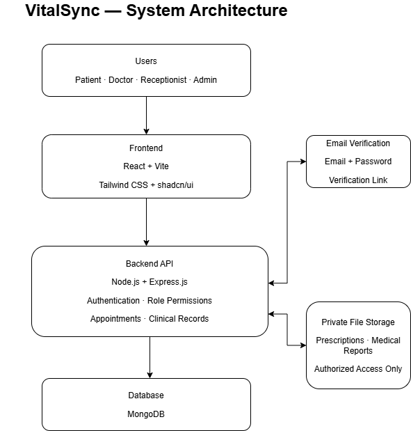
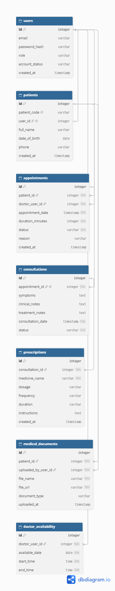

# VitalSync — Healthcare EHR Dashboard

> A full-stack Electronic Health Record (EHR) and hospital appointment management system designed for a single hospital or clinic.

## Live URL 
**Frontend** : https://capstonevitalsync.vercel.app

**Backend** : https://capstone-vitalsync.onrender.com


## 1. Project Overview

**VitalSync** is a web-based healthcare management application that helps a hospital manage patient registration, appointments, consultation records, prescriptions, and follow-up visits through a centralized system.

The application provides role-specific dashboards for patients, doctors, receptionists, and administrators. It aims to reduce manual record management, simplify appointment scheduling, and make relevant patient history accessible to authorized healthcare professionals.

The project is planned as a full-stack capstone application. Features and architecture described in this document represent the intended scope and may change during implementation.

## 2. Project Details

- **Project Name:** VitalSync
- **Project Type:** Healthcare EHR Dashboard
- **Development Track:** Fullstack
- **Target Environment:** Single hospital or clinic
- **Primary Goal:** Build a modern, usable frontend with a functional backend and database.
- **Development Status:** Planning and requirements definition
- **Repository:** `prodesk-capstone-VitalSync`

## 3. Problem Statement

Hospitals and clinics may manage patient information, appointments, prescriptions, and consultation history across disconnected or manual processes. This can make it difficult to locate previous records, coordinate appointments, and maintain consistent information.

VitalSync aims to provide a centralized system where authorized staff can manage appointments and patient records, doctors can document consultations, and patients can access their own medical information.

## 4. Technology Stack

The following stack is proposed for implementation and has not yet been verified through a working application.

| Layer | Planned Technology |
|---|---|
| Frontend | React.js with Vite |
| Styling | Tailwind CSS |
| UI Components | shadcn/ui |
| Backend | Node.js |
| API Framework | Express.js |
| Database | MongoDB |
| Authentication | Email and password with email verification |
| Version Control | Git and GitHub |
| UI Design | Figma |
| Architecture Diagrams | Draw.io or dbdiagram.io |

External email verification and delivery services will be selected based on free-tier availability, usage limits, and implementation requirements.


## 5. User Roles and Permissions

### 5.1 Patient

- Register for an account and verify their email address.
- Access their own patient record after secure account linking.
- View appointments, consultation history, treatment details, and prescriptions.
- Book, cancel, or reschedule appointments according to the hospital's scheduling policy.
- Upload previous prescriptions and medical reports from external providers.
- Remove their own uploaded files, subject to applicable retention and audit requirements.
- View upcoming follow-up appointments.

Patients cannot modify or delete doctor-created clinical records.

### 5.2 Receptionist

- Register walk-in patients and manage patient details needed for registration.
- Search for patients using their Patient ID or a combination of name and phone number.
- Review possible duplicate records before creating a new patient record.
- Book appointments on behalf of patients.
- Check patients in and manage the waiting queue.
- Assist with account linking through an authorized verification process.

Receptionists will not have routine access to detailed clinical notes, diagnoses, or prescriptions.

### 5.3 Doctor

- View their appointments and waiting queue.
- Access relevant previous hospital history for patients they are authorized to treat.
- Review patient-uploaded external prescriptions and reports, clearly distinguished from verified hospital records.
- Record consultation notes, treatment details, and prescriptions.
- Schedule follow-up appointments.
- Complete a consultation and proceed to the next eligible patient without losing unsaved work.

Clinical access will be enforced by the backend, not only by hiding frontend components.

### 5.4 Admin

- Manage staff accounts and role assignments.
- Manage doctor profiles and hospital configuration.
- Configure doctor availability and appointment durations.
- Oversee operational workflows and appropriate audit records.

An administrator role will not automatically grant unrestricted access to all clinical information.

## 6. Functional Requirements

### 6.1 Authentication and Patient Registration

- Support email-and-password authentication.
- Require email verification for online account registration.
- Generate a unique Patient ID for each hospital patient record.
- Allow receptionists to register walk-in patients without requiring an online patient account.
- Allow patients to securely link an online account to an existing hospital record.
- Use staff-assisted identity verification and a one-time linking mechanism when linking existing records.
- Detect possible duplicate patients before creating a new record.
- Permit shared family phone numbers; phone numbers will not be treated as unique identifiers.

Email verification proves access to an email address, not ownership of a medical record. Patient ID or phone number alone must not authorize access to clinical information.

### 6.2 Patient Search and Duplicate Handling

- Search primarily by Patient ID.
- Support alternative searches using patient name and phone number.
- Display possible matches for authorized staff to review.
- Allow record creation when no suitable match is found, after a duplicate warning.
- Require authorized review before merging duplicate records.
- Link appointments to the patient record rather than only to the account that created the appointment.

### 6.3 Appointment Management

- Allow patients and receptionists to book appointments.
- Use doctor availability and configured appointment duration to determine suitable slots.
- Prevent overlapping confirmed appointments for the same doctor.
- Recheck slot availability when confirming a booking.
- Allow cancellation and rescheduling according to the hospital's configured policy.
- Record the appointment's status and relevant changes.

**Normal walk-in rule:** A walk-in appointment may be accommodated only when a sufficiently long free gap is available. Otherwise, the patient will be offered the next available slot and may accept or decline it. Existing confirmed appointments will not be silently displaced.

Emergency triage and emergency-priority scheduling are outside the initial scope.

### 6.4 Consultation and Clinical Records

- Maintain consultation history for the hospital.
- Allow authorized doctors to document consultation notes, treatments, and prescriptions.
- Support follow-up appointment scheduling.
- Keep doctor-created clinical records separate from patient-uploaded external documents.
- Restrict patients to viewing doctor-created clinical records.
- Use a traceable correction process for clinical records rather than silent overwrites or deletion.

### 6.5 Waiting Queue

- Display relevant appointment and check-in information to authorized staff.
- Allow doctors to complete the current consultation and move to the next eligible patient.
- Preserve consultation data until it is saved.
- Show an appropriate empty-queue state when no eligible patients are waiting.
- Avoid exposing diagnoses, prescriptions, or other private clinical details on public queue displays.

The initial queue will handle normal appointments and walk-ins. Emergency prioritization and advanced queue optimization are not included.

### 6.6 Medical Document Uploads

- Allow patients to upload previous prescriptions and reports.
- Label uploaded files as patient-provided external documents.
- Record upload date and source information where available.
- Restrict file access to authorized users.
- Validate supported file types and size limits.
- Support removal requests for patient-uploaded files while retaining appropriate audit information and complying with applicable retention requirements.

### 6.7 Audit and Accountability

Record important events such as patient-record creation, appointment changes, clinical-record corrections, document uploads and removals, and relevant permission changes.

Audit records should identify the responsible account and event time while avoiding unnecessary exposure of sensitive information.

## 7. Prioritized Feature Scope

### Must Have — Initial Version

- Role-based authentication and authorization.
- Patient registration and unique Patient IDs.
- Duplicate-patient warnings and patient search.
- Patient account linking with verification.
- Doctor availability and appointment booking.
- Receptionist-assisted booking and walk-in handling.
- Doctor consultation notes and prescriptions.
- Patient access to their own records.
- Patient-uploaded external medical documents.
- Basic follow-up scheduling and waiting queue.
- Server-side access controls and audit logging.

### Should Have — After Core Workflows

- Improved appointment and queue management.
- More detailed operational dashboards.
- Better search and filtering.
- Additional audit history views.
- Improved error handling and accessibility.
- Automated tests for critical workflows and permissions.

### Out of Scope for Initial Version

- Emergency triage and emergency-priority scheduling.
- Cross-hospital record sharing or multi-organization integration.
- Pharmacy, laboratory, insurance, and billing integrations.
- AI-generated diagnoses or treatment recommendations.
- Advanced analytics and clinical decision support.

These features may be reconsidered after the initial workflows are stable.

## 8. Security and Privacy Requirements

VitalSync will handle sensitive health-related information, so privacy and access control are core design requirements.

- Enforce authorization on every protected backend endpoint.
- Use secure password hashing and appropriate session or token handling.
- Protect account recovery and patient-record linking workflows.
- Keep medical files private and serve them only through authorized access.
- Store secrets in environment variables rather than source code.
- Avoid logging passwords, authentication secrets, or unnecessary clinical information.
- Maintain appropriate audit records for important operations.
- Use synthetic patient data during development, testing, and demonstrations.
- Define data retention, deletion, backup, and recovery requirements before production deployment.

This project will not be described as production-ready or legally compliant without appropriate security testing, deployment safeguards, and a review of applicable healthcare and privacy requirements.

## 9. Proposed Architecture

The intended application architecture is:

**React frontend → Express REST API → MongoDB database**

The frontend will provide role-specific interfaces. The Express backend will handle authentication, authorization, business rules, appointment scheduling, clinical-record operations, and document-access checks. MongoDB will store application records and their relationships.

Medical documents will require private storage and controlled access; they should not be exposed through unrestricted public file URLs.


The architecture diagram below illustrates the planned application components and their interactions.




## 10. Proposed Data Model

The following collections are preliminary and will be refined during database design.


| Collection | Purpose |
|---|---|
| `users` | Login identity, email verification status, and account role |
| `patients` | Patient demographics and unique hospital Patient ID |
| `appointments` | Booking details, status, timing, and patient/doctor references |
| `consultations` | Consultation notes, treatment details, and follow-up information |
| `prescriptions` | Doctor-created prescription records |
| `medical_documents` | Metadata and access information for uploaded medical files |
| `doctor_availability` | Doctor availability dates and time slots |


The exact fields, references, validation rules, and indexes will be defined in the ERD/data-modeling stage. The `users` collection and `patients` collection will remain conceptually separate so that a walk-in patient can have a hospital record without an online account.


### ERD — Proposed Data Model

The following diagram presents the preliminary data model for VitalSync. It uses a relational-style diagram to represent the planned entities and their relationships; the actual database implementation will use MongoDB collections and document references.




## 11. UI/UX Design

The interface will aim to provide a clean, accessible, and responsive healthcare dashboard.

Planned design principles:

- Role-specific dashboards and navigation.
- Clear appointment status and queue information.
- Readable clinical-record layouts.
- Consistent form validation and error messages.
- Responsive layouts for desktop, tablet, and mobile.
- Accessible colors, labels, and interaction states.

### Required Design Viewports

1. **Authentication:** Login, registration, and verification states.
2. **Main Dashboard:** A role-specific overview with relevant actions and information.
3. **Data Details:** Patient details and the appropriate appointment or clinical-record view.

**Figma link:** [View VitalSync UI Design](https://www.figma.com/design/RRfDffynKCDUCagvfzQ9v2/VitalSync---UI-Design?node-id=0-1&t=jRqihg7dzEbzvJsA-1)

## 12. Capstone Deliverables

- **P0 — Repository and PRD:** Public GitHub repository with this README, project overview, track, planned technology stack, and prioritized features.
- **P1 — UI Design:** At least three Figma screens or equivalent high-fidelity sketches, with a shareable link added here.
- **P2 — Architecture and Data Model:** Architecture diagram and database/relationship diagram, exported and embedded in the README.

These deliverables will be completed during the planning phase before functional implementation begins.

## 13. Development Roadmap

1. Finalize requirements and business rules.
2. Create the three required UI designs.
3. Draft and review the architecture and data model.
4. Define API contracts and access-control rules.
5. Implement authentication and patient registration.
6. Implement appointment booking and scheduling rules.
7. Implement consultation, prescription, and document workflows.
8. Add audit logging, validation, and error handling.
9. Test role permissions, duplicate handling, scheduling conflicts, and account linking.
10. Prepare deployment and documentation.

The roadmap is proposed; completion will be tracked as implementation progresses.

## 14. Sprint 15

- **Development Status:** Authentication MVP implemented and deployed
- **Repository:** https://github.com/shahira-sohail/capstone-vitalSync

| Layer | Implemented Technology |
|---|---|
| Frontend | React.js with Vite |
| Styling | CSS |
| Backend | Node.js |
| API Framework | Express.js |
| Database | MongoDB Atlas |
| ODM | Mongoose |
| Authentication | JWT |
| Password Security | bcryptjs |
| API Testing | Postman |
| Version Control | Git and GitHub |
| Deployment | Vercel and Render |
| UI Design | Figma |
| Architecture Diagrams | Draw.io |

## Implemented Features — Authentication MVP

The initial authentication MVP has been implemented and deployed.

### Backend
- User registration API.
- User login API.
- Password hashing using bcryptjs.
- JWT-based authentication.
- Authentication middleware for protected routes.
- MongoDB Atlas integration.
- Protected dashboard API endpoint.

### Frontend
- Responsive login page.
- User registration page.
- React Router navigation.
- Backend API integration.
- JWT storage using localStorage.
- Protected dashboard routing.
- Token verification through the backend.
- Logout functionality.

### Deployment
- Frontend deployed on Vercel.
- Backend deployed on Render.
- Production database hosted on MongoDB Atlas.

### Current Implementation Scope

The current working MVP covers authentication and protected dashboard access. Patient management, appointment scheduling, consultations, prescriptions, and role-based authorization remain part of the planned development scope.

## Development Roadmap

1. Requirements and business rules — Completed.
2. Initial UI design and architecture documentation — Completed.
3. Database schema planning — Completed.
4. Authentication backend implementation — Completed.
5. React frontend authentication integration — Completed.
6. Production deployment of backend and frontend — Completed.
7. Production API and authentication testing — Completed.
8. Role-based authentication and authorization — Pending.
9. Patient registration and patient record management — Pending.
10. Appointment booking and scheduling — Pending.
11. Consultation and prescription workflows — Pending.
12. Medical document management — Pending.
13. Audit logging and comprehensive testing — Pending.

The roadmap will be updated as implementation progresses.

## 15. Success Criteria

The initial version will be considered functionally successful when:

- Different roles can access only the operations permitted to them.
- A walk-in patient can be registered without an online account.
- An existing patient can securely link an account without exposing another patient's records.
- Appointment conflicts are prevented under concurrent booking attempts.
- Doctors can save consultations and prescriptions and proceed through the waiting queue.
- Patients can view their own records and manage their uploaded external documents within the defined rules.
- Important changes are traceable through audit records.
- The application passes tests using synthetic patient data.

## 16. Disclaimer

VitalSync is an educational capstone project intended to demonstrate full-stack application development and healthcare workflow planning. It is not a substitute for professional medical systems, clinical judgment, or a production-ready EHR platform.

No real patient data should be used in the development or demonstration environment.

## Sprint 14 – REST API CRUD Finalization & Gateway Monetization

### Engineering Objective

Finalize secure REST API controllers, implement data ownership validation, connect React frontend with backend CRUD operations, and integrate a third-party payment gateway for test-mode monetization.

---

### Phase 1 – Secure Backend CRUD (P0)

**Primary Resource:** Appointments

Implemented JWT-protected REST API endpoints for appointment management.

**CRUD Operations:**

- **POST** `/api/appointments` – Create a new appointment.
- **GET** `/api/appointments` – Retrieve appointments belonging to the authenticated user.
- **PUT** `/api/appointments/:id` – Update an existing appointment.
- **DELETE** `/api/appointments/:id` – Delete an appointment.

**Security and Data Ownership:**

- Protected appointment routes using JWT authentication middleware.
- Extracted authenticated user identity from the decoded JWT.
- Associated appointment records with their owning user.
- Applied ownership validation to prevent users from accessing or modifying appointments belonging to other users.
- Used appropriate HTTP status codes for successful operations, missing resources, and unauthorized access.

---

### Phase 2 – Client Integration & State Management (P1)

Connected the React frontend to the appointment REST APIs.

**Implemented Features:**

- Integrated frontend services for appointment API communication.
- Connected appointment creation, retrieval, updating, and deletion with backend endpoints.
- Used React state management to keep appointment data synchronized with the UI.
- Implemented appointment management through the dashboard without requiring full-page reloads.
- Integrated authenticated API requests using JWT tokens.

**Frontend Integration:**
- React
- Vite
- JavaScript
- Fetch API
- React Hooks (`useState`, `useEffect`)

---

### Phase 3 – Gateway Monetization (P2)

**Payment Gateway:** PayU Hosted Checkout (UAT / Test Mode)

The original assignment specified Stripe Test Mode. PayU was used as an alternative test-mode gateway because of payment gateway onboarding constraints. This substitution remains subject to project/mentor approval.

**Implemented Features:**

- Added a VitalSync Pro test subscription payment trigger.
- Configured the test payment amount of ₹499.
- Generated unique transaction IDs for payment attempts.
- Implemented SHA-512 payment request hash generation.
- Created and stored payment records in MongoDB.
- Integrated PayU Hosted Checkout redirection.
- Configured success and failure callback endpoints.
- Implemented callback hash validation.
- Added transaction amount and transaction-detail verification.
- Integrated PayU Verify Payment API.
- Updated payment status in MongoDB after gateway verification.
- Implemented an authenticated payment status endpoint.
- Created a frontend payment result page.

**Payment Transaction Flow:**

1. Authenticated user initiates a test payment.
2. Backend generates a transaction ID and creates a Pending payment record.
3. User is redirected to PayU Hosted Checkout.
4. PayU returns the transaction response to the backend callback.
5. Backend validates the callback and verifies the transaction with PayU.
6. Verified transaction status is saved in MongoDB.
7. User is redirected to the payment result page.

---

### Deployment

- **Frontend:** https://capstonevitalsync.vercel.app
- **Backend:** https://capstone-vitalsync.onrender.com
- **Database:** MongoDB Atlas

### Notes

- Payment testing was performed in PayU UAT mode; no real-money transaction was made.
- PayU is an alternative to the originally specified Stripe integration and requires mentor/project approval.
- Payment success is verified through the gateway response and the corresponding MongoDB transaction record.
- Additional subscription entitlement activation and failure-scenario testing are outside the currently verified completion scope.

# Sprint 16 – AI Endpoint Architecture & Backend Hardening

## Overview

Sprint 16 focused on architecting a secure, server-side AI microservice and strengthening the VitalSync REST API through standardized error handling, strict payload validation, rate limiting, and production code sanitization.

The primary objective was to improve backend reliability, prevent invalid requests from reaching the database, securely integrate Gemini AI, and protect critical API endpoints from excessive requests.

---

## Phase 1: Error Handling & Payload Validation (P0)

Implemented centralized error handling and strict request validation to improve API reliability and prevent malformed data from entering the database.

### Key Implementations

- Integrated **Zod** for strict request payload validation.
- Created reusable request validation middleware.
- Implemented validation schemas for:
  - Authentication
  - Appointments
  - Payments
  - AI requests
- Added centralized error-handling middleware.
- Wrapped asynchronous route handlers in `try/catch` blocks.
- Standardized API error responses with appropriate HTTP status codes:
  - `400 Bad Request` – Invalid request payload.
  - `401 Unauthorized` – Authentication failure.
  - `404 Not Found` – Requested API route does not exist.
  - `500 Internal Server Error` – Unexpected server-side errors.
- Prevented internal error details from being exposed in production responses.
- Rejected unexpected request fields using strict schema validation.

### Validation Examples

| Test Scenario | Expected Result |
|---|---|
| Invalid registration payload | HTTP 400 |
| Invalid login payload | HTTP 400 |
| Missing appointment fields | HTTP 400 |
| Empty appointment update | HTTP 400 |
| Invalid payment callback payload | HTTP 400 |
| Non-existent API route | HTTP 404 |

---

## Phase 2: Server-Side AI Microservice (P1)

Integrated Google's Gemini AI into the Express backend to generate AI-powered suggestions securely.

### Key Implementations

- Integrated the `@google/genai` Node.js SDK.
- Created a dedicated AI service:
  - `backend/services/aiService.js`
- Implemented a dedicated AI API endpoint:

  **POST `/api/ai/suggest`**

- Secured the endpoint using JWT authentication.
- Implemented Zod validation for AI prompts:
  - Minimum prompt length: 5 characters.
  - Maximum prompt length: 1000 characters.
  - Rejects unexpected request fields.
- Stored the Gemini API key in server-side environment variables.
- Configured AI output token limits and request timeout.
- Added graceful handling of AI service failures and empty responses.
- Ensured the AI SDK executes exclusively on the backend rather than the React client.

### AI Request Example

**Endpoint:**
```http
POST /api/ai/suggest
```

**Request Body:**
```json
{
  "prompt": "Suggest three general healthy lifestyle habits for improving overall wellness."
}
```

**Successful Response:**
```json
{
  "success": true,
  "message": "AI suggestion generated successfully",
  "suggestion": "AI-generated suggestion..."
}
```

*The suggestion content is generated dynamically by Gemini.*

---

## Phase 3: Security & Throttling (P2)

Implemented rate limiting and production sanitization to protect backend infrastructure and reduce unauthorized or excessive API usage.

### 1. Authentication Rate Limiting

- Integrated `express-rate-limit`.
- Protected the login endpoint:

  **POST `/api/auth/login`**

- Maximum 5 failed login attempts within a 15-minute window per IP address.
- Successful login requests are excluded from the failure count.
- Returns HTTP `429 Too Many Requests` when the configured limit is exceeded.

### 2. AI Rate Limiting

- Protected the AI suggestion endpoint:

  **POST `/api/ai/suggest`**

- Maximum 10 AI requests within a 15-minute window per authenticated user.
- Uses the authenticated user's ID as the rate-limit key.
- Returns HTTP `429 Too Many Requests` when the limit is exceeded.
- Helps control excessive AI API usage and protects the backend from request abuse.

### 3. Production Code Sanitization

- Removed all `console.log()` statements from the production backend.
- Retained `console.error()` for server-side error diagnostics.
- Prevented sensitive internal error details from being exposed in API responses.

---

## QA Testing & Verification

The following tests were performed to verify Sprint 16 implementations.

| Test Case | Expected Result | Status |
|---|---|---|
| Valid AI suggestion request | HTTP 200 with generated suggestion | Passed |
| Unauthenticated AI request | HTTP 401 Unauthorized | Passed |
| Prompt shorter than 5 characters | HTTP 400 Bad Request | Passed |
| Unexpected field in AI payload | HTTP 400 Bad Request | Passed |
| AI request after exceeding rate limit | HTTP 429 Too Many Requests | Passed |
| Invalid registration payload | HTTP 400 Bad Request | Passed |
| Invalid login payload | HTTP 400 Bad Request | Passed |
| Invalid API route | HTTP 404 Not Found | Passed |
| Invalid appointment payload | HTTP 400 Bad Request | Passed |
| Empty appointment update | HTTP 400 Bad Request | Passed |
| Invalid payment callback payload | HTTP 400 Bad Request | Passed |

### Rate Limiting Verification

Repeated AI requests were sent through Postman using an authenticated request.

After reaching the configured request limit, the backend rejected further requests and returned:

- HTTP Status: `429 Too Many Requests`
- Response:
```json
{
  "success": false,
  "message": "Too many AI requests. Please try again after 15 minutes."
}
```

This confirmed that the AI rate-limiting middleware was functioning as expected.

---

## Technologies & Tools Used

| Technology | Purpose |
|---|---|
| Node.js | Backend runtime |
| Express.js | REST API development |
| MongoDB | Database |
| Mongoose | MongoDB object modeling |
| Zod | Request payload validation |
| Google Gemini AI | AI suggestion generation |
| `@google/genai` | Gemini Node.js SDK |
| `express-rate-limit` | API rate limiting |
| JWT | Authentication |
| Postman | API testing |

---

## Important Backend Files

```text
backend/
├── middleware/
│   ├── authMiddleware.js
│   ├── authRateLimiter.js
│   ├── aiRateLimiter.js
│   ├── validateRequest.js
│   └── errorMiddleware.js
│
├── routes/
│   ├── authRoutes.js
│   └── aiRoutes.js
│
├── services/
│   └── aiService.js
│
├── validators/
│   └── aiValidator.js
│
├── server.js
└── .env
```

*Note: The project also contains other existing backend routes, models, middleware, and validators that are not listed above.*

---

## Sprint 16 Outcome

Successfully implemented a secure server-side AI integration using Google Gemini and strengthened the VitalSync backend with centralized error handling, strict Zod-based request validation, JWT-protected AI access, authentication and AI rate limiting, and production code sanitization.

The implementation and Postman QA demonstrations verified successful AI execution, rejection of malformed payloads, and enforcement of the configured AI request limit.

**Sprint 16 Status: Completed**

# Sprint 17: Cloud Deployment & Live Integration

## Phase 1: Backend Provisioning (P0 – Mandatory)

**Cloud Hosting:**
- Deployed the Node.js/Express backend on Render.
- Configured the production backend environment.
- Verified successful backend deployment.

**Boot Script:**
- Configured the backend `package.json` with the required start script:

```json
"scripts": {
  "start": "node server.js"
}
```

- Verified that the application starts successfully on the cloud server.

**Live Backend URL:**

https://capstone-vitalsync.onrender.com

---

## Phase 2: Production Security & Network Configuration (P1 – Priority)

**MongoDB Atlas Network Access:**
- Updated MongoDB Atlas Network Access to include `0.0.0.0/0` (Global Access).
- Enabled the deployed cloud backend to connect to the MongoDB Atlas cluster.

**CORS Configuration:**
- Replaced wildcard CORS access with an explicit origin allowlist.
- Configured the Express backend to accept requests from the deployed frontend only.
- Rejected requests originating from unauthorized frontend origins, including localhost.
- Allowed requests without an Origin header for non-browser API clients.

**Allowed Production Origin:**

https://capstonevitalsync.vercel.app

---

## Phase 3: The Live Integration (P2 – Advanced)

**Client Pipeline:**
- Configured the Vercel production environment variable `VITE_API_URL` to point to the live Render backend.
- Updated the frontend API configuration to use the deployed backend instead of the local development server.
- Verified successful communication between the deployed React frontend and Express backend.

**End-to-End Integration Testing:**

Performed live integration testing using the deployed application.

| Test | Result |
|---|---|
| Live frontend deployment | Successful |
| Frontend-to-backend communication | Successful |
| CORS configuration | Verified |
| GET `/api/appointments` | 200 OK |
| Appointment creation through frontend | Successful |
| Appointment visibility after page refresh | Verified |
| MongoDB Atlas persistence | Verified |

**Database Verification:**
- Created a test appointment through the deployed React frontend.
- Verified that the appointment remained visible after refreshing the dashboard.
- Confirmed that the newly created appointment was persisted in MongoDB Atlas.

---

## Deployment URLs

| Component | URL |
|---|---|
| React Frontend (Vercel) | https://capstonevitalsync.vercel.app |
| Node.js Backend (Render) | https://capstone-vitalsync.onrender.com |

## Phase 3 Completion Status

**Result:** Successfully deployed and integrated the React frontend, Node.js/Express backend, and MongoDB Atlas database. Verified live API communication and end-to-end appointment persistence.

